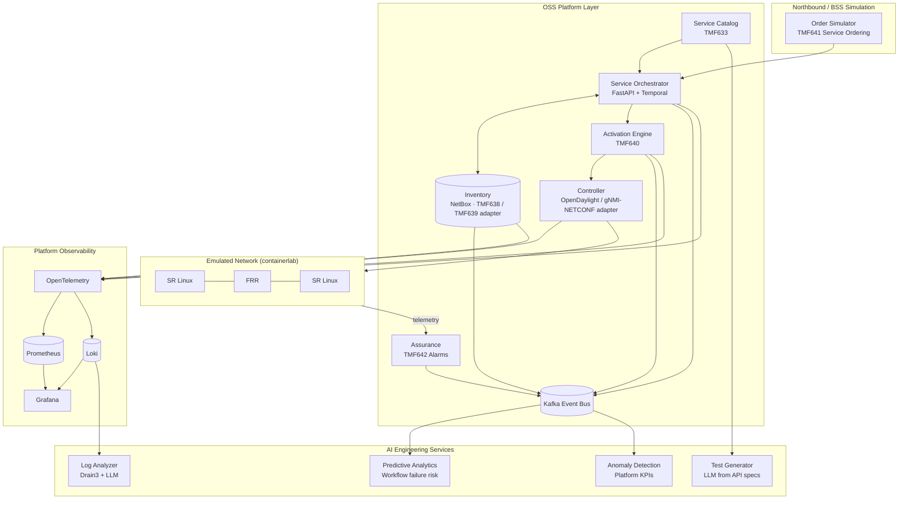

# OSS Automation Platform Lab

**An open-source reference build of a carrier OSS automation ecosystem: platform integration, N/N+1 validation, network and service onboarding, lifecycle orchestration, and AI-assisted test automation and operational intelligence.**

The focus is the **platform layer**, not the network itself: how inventory, orchestration, controllers, activation, and assurance systems are integrated, upgraded, validated, and kept in sync, and how AI makes that engineering work faster and more reliable.

> **Scope note.** Independent lab built from public, open-source tools, open standards (TM Forum Open APIs, OpenConfig, YANG), and synthetic data. No proprietary employer code, configurations, data, or system names.

---

## Status

Runnable today with **no Docker or Kubernetes** (`make bootstrap && make ci`): the platform core, the
N/N+1 qualification harness, the onboarding gate, and the AI engineering services, all covered by tests.

| Area | State |
|---|---|
| Catalog, orchestrator (compensation, retries, idempotency), inventory, activation, controller/device simulator, assurance | Built, in-memory, behind TMF633/638/639/640/641/642-style HTTP APIs |
| Three-way reconciliation (intended vs controller vs device) | Built, 8 finding types |
| N/N+1 readiness report (scenarios, OpenAPI contract diff, state migration, performance, go/no-go) | Built; works in-process or against two deployed URLs |
| Onboarding framework | Built; 1 device type + 2 service models pass the gate |
| AI: anomaly detection, log template mining, failure prediction, test drafting, workflow analytics + root cause | Built, deterministic, advisory; models trained on synthetic data |
| NetBox, Kafka, Temporal, OpenDaylight, containerlab, Kubernetes/Helm, Argo CD, Prometheus/Loki/Grafana | **Not built yet** (stand-ins sit behind the same interfaces; see `docs/adr/0002-in-process-first.md`) |
| Schemathesis API fuzzing; mixed-version interop (orchestrator x activation) | Built |
| Pact consumer contracts, pyATS/Robot | **Not built yet** |

---

## Table of Contents

1. [What This Lab Demonstrates](#what-this-lab-demonstrates)
2. [Architecture](#architecture)
3. [Tech Stack](#tech-stack)
4. [Repository Layout](#repository-layout)
5. [Quick Start](#quick-start)
6. [Platform Modules](#platform-modules)
7. [N/N+1 Platform Validation](#nn1-platform-validation)
8. [Onboarding Framework](#onboarding-framework)
9. [AI for Platform Engineering](#ai-for-platform-engineering)
10. [Testing & CI/CD](#testing--cicd)
11. [Documentation Set](#documentation-set)
12. [Build Roadmap](#build-roadmap)
13. [Role-to-Module Mapping](#role-to-module-mapping)

---

## What This Lab Demonstrates

| Capability | How it shows up here |
|---|---|
| OSS ecosystem integration | Inventory, ordering, orchestration, controller, activation, and assurance components wired together through TM Forum Open APIs and Kafka |
| N/N+1 lab environments | Two complete platform stacks (current and candidate versions) with an automated regression and interoperability suite |
| Network & service onboarding | Repeatable onboarding pipeline for new device types, applications, and service models |
| Lifecycle workflow validation | Provisioning → activation → assurance → modify → decommission, tested end to end |
| Data integrity across systems | Cross-system reconciliation between inventory, controller, and network state |
| AI-enhanced engineering | LLM-generated test cases, log analysis, predictive workflow-failure analytics, anomaly detection on platform KPIs |

---

## Architecture



**Design principle:** every component is an independently versioned service with a standard API contract, so any one of them can be upgraded, swapped, or validated in isolation.

---

## Tech Stack

| Layer | Tools |
|---|---|
| Standards | TM Forum Open APIs (TMF633, 638, 639, 640, 641, 642), OpenConfig, YANG, NETCONF, gNMI |
| Inventory | NetBox + custom TMF adapter |
| Orchestration | Python 3.12, FastAPI microservices, Temporal workflows |
| Controller | OpenDaylight (optional) or lightweight NETCONF/gNMI controller service |
| Network emulation | containerlab, Nokia SR Linux, FRRouting |
| Messaging | Kafka, Schema Registry (Avro) |
| Observability | OpenTelemetry, Prometheus, Loki, Grafana |
| Testing | pytest, Schemathesis (API contract fuzzing), Pact (consumer contracts), pyATS, Robot Framework |
| AI / ML | scikit-learn, pandas, Drain3, LLM API + pgvector |
| Platform | Linux, Docker, Kubernetes (kind / k3d), Helm, GitHub Actions, Argo CD |

**Reference:** ONAP, the open-source orchestration platform that grew out of AT&T's ECOMP, informs the component boundaries here (catalog, service orchestration, inventory, controllers, assurance). This lab uses a lighter-weight implementation that runs on a single workstation.

---

## Repository Layout

```
.
├── src/oss_lab/
│   ├── core/            # catalog, orchestrator, inventory, activation, controller, assurance,
│   │                    #   reconciliation, event bus, HTTP API, stack composition
│   ├── validation/      # scenarios, OpenAPI contract diff, N/N+1 runner, readiness report, CLI
│   ├── onboarding/      # onboarding pipeline + CLI
│   ├── ai/              # anomaly, log_analysis, predictive, test_generation, workflow_opt
│   └── main.py          # ASGI entrypoint (OSS_LAB_RELEASE=n|n1)
├── onboarding/          # device-type and service-model packages (YAML)
├── environments/        # n/ and n1/ release values
├── validation/reports/  # generated readiness reports
├── tests/
├── docs/                # architecture, validation plan, onboarding, deployment, runbooks, adr/
├── Dockerfile, docker-compose.yml, Makefile
└── .github/workflows/ci.yml
```

The package is `oss_lab` rather than `platform` because a top-level `platform` would shadow the
standard library (ADR 0001).

---

## Quick Start

**Requirements:** Linux/macOS/WSL2 and Python 3.11+.

```bash
git clone https://github.com/babalekpam/oss-automation-platform-lab.git
cd oss-automation-platform-lab

make bootstrap          # venv + editable install
make test               # unit, lifecycle, reconciliation, validation, onboarding, AI tests
make validate           # N vs N+1 readiness report -> validation/reports/
make onboard            # onboarding gate for every package
make run-n              # serve release N on http://localhost:8080/docs
```

Qualify two deployed releases: `make run-n` and `make run-n1` in two shells, then
`make validate-remote N_URL=http://localhost:8080 N1_URL=http://localhost:8081`.

| Service | URL |
|---|---|
| Orchestrator and TMF APIs (OpenAPI) | http://localhost:8080/docs |
| Metrics / events / reconciliation | `/metrics`, `/events`, `/reconciliation/report` |

---

## Platform Modules

### Service Catalog & Ordering
- Service specifications defined once, consumed by orchestrator, activation, and assurance.
- Order simulator generates realistic TMF641 order traffic (create, modify, suspend, terminate).

### Service Orchestration
- Temporal workflows decompose service orders into resource actions.
- Each step is idempotent, retryable, and emits lifecycle events to Kafka.
- Compensation (rollback) paths are first-class and tested.

### Inventory & Synchronization
- NetBox as resource inventory, exposed through a TMF638/639 adapter.
- Reconciliation jobs compare **intended** (inventory), **controller view**, and **actual** (device) state, producing a data-integrity report: missing objects, orphaned services, attribute drift, stale references.

### Activation & Controller
- Model-driven config rendering from service definitions.
- Southbound via NETCONF/gNMI with transactional commit and verification.

### Assurance
- Telemetry and alarms correlated to service instances, so health is reported per service, not just per device.

---

## N/N+1 Platform Validation

Qualifies a new release of any platform component before it reaches production.

1. Deploy `environments/n` (current) and `environments/n1` (candidate) as parallel stacks.
2. Run identical suites against both:
   - **API contract tests:** no breaking changes to TMF or internal APIs
   - **Lifecycle scenarios:** every service type through every lifecycle state
   - **Interoperability:** N+1 component against N neighbors (mixed-version compatibility)
   - **Data migration:** inventory and workflow state survive the upgrade intact
   - **Performance:** order throughput, workflow latency, API p95/p99
   - **Observability:** metrics, logs, and traces still emitted and parsable
3. Generate a readiness report: pass/fail matrix, behavioral diffs, performance deltas, known issues, go/no-go.

```bash
make validate FROM=n TO=n1 COMPONENT=orchestrator
```

---

## Onboarding Framework

A repeatable path for bringing something new into the platform.

| Onboarding type | Pipeline steps |
|---|---|
| **New device type / OS** | YANG model import → template build → controller adapter test → inventory model → activation test → assurance enrollment |
| **New service model** | Catalog spec → decomposition rules → workflow → lifecycle tests → assurance mapping |
| **New application / platform** | API contract registration → event schema registration → integration tests → observability hooks → runbook |

Each onboarding package ships with acceptance criteria and must pass the full gate in CI before it is marked ready.

---

## AI for Platform Engineering

| Use case | Approach |
|---|---|
| **Test automation** | LLM reads OpenAPI/TMF specs and service models, drafts pytest and lifecycle scenarios; humans review, CI executes |
| **Log analysis** | Drain3 clusters platform logs into templates; LLM summarizes new or spiking patterns after deployments and test runs |
| **Event correlation** | Links failures across orchestrator, activation, and controller using trace IDs and order IDs to find the originating component |
| **Predictive analytics** | Model on historical workflow runs predicts orders likely to fail (by service type, target device, payload attributes) before execution |
| **Anomaly detection** | Seasonal baselines + Isolation Forest on platform KPIs: workflow latency, error rates, sync drift, queue lag |
| **Workflow optimization** | Analysis of Temporal execution history to identify slow or retry-heavy steps |
| **N/N+1 report drafting** | LLM converts raw regression results into a readable readiness summary for stakeholders |

**Guardrails:** AI output is advisory. Generated tests are reviewed before merge; nothing AI-generated changes platform or network state directly. All models are evaluated against labeled historical runs with tracked precision and recall.

---

## Testing & CI/CD

- **Unit:** each microservice, templates, adapters
- **Contract:** Pact between consumers and providers; Schemathesis fuzzing of every API
- **Integration:** ephemeral kind cluster + containerlab topology per pull request
- **Lifecycle E2E:** full order-to-assurance scenarios
- **Pipeline:** GitHub Actions (lint → unit → contract → build → ephemeral E2E → report) and Argo CD for GitOps deployment of N and N+1 environments

---

## Documentation Set

| Document | Purpose |
|---|---|
| `docs/architecture.md` | Component boundaries, APIs, event flows |
| `docs/deployment-guide.md` | Build N and N+1 environments from zero |
| `docs/validation-plan.md` | Test strategy, entry/exit criteria, release qualification |
| `docs/onboarding-procedure.md` | Device, service, and application onboarding |
| `docs/runbooks/` | Workflow stuck, sync drift, activation failure, event backlog |
| `docs/adr/` | Key design decisions and trade-offs |

---

## Build Roadmap

| Phase | Deliverable | Est. effort |
|---|---|---|
| 1 | Kubernetes stack: NetBox, Kafka, observability, containerlab network | 1 week (not started) |
| 2 | Catalog, orchestrator, activation, controller services with TMF APIs | 2–3 weeks (**done**, in-memory) |
| 3 | Lifecycle E2E tests + inventory reconciliation | 1–2 weeks (**done**) |
| 4 | N/N+1 environments + regression/interop suite + readiness report | 2 weeks (**done**; interop covers 2 components) |
| 5 | Onboarding framework with one device type and two service models | 1 week (**done**) |
| 6 | AI services: test generation, log analysis, predictive analytics, anomaly detection | 2–3 weeks (**done**, synthetic data, no LLM wired) |
| 7 | CI/CD, GitOps, documentation, demo video | 1 week (CI + docs done; GitOps, video not started) |

---

## Role-to-Module Mapping

| Job requirement | Module |
|---|---|
| AI-driven automation solutions | `ai/`, `platform/orchestrator` |
| Automation workflows via APIs, orchestration, enterprise systems | `platform/`, TMF adapters |
| Validate inventory sync, orchestration, workflow execution, telemetry, integrations | `validation/reconciliation`, `validation/lifecycle`, `validation/interop` |
| Build and maintain N/N+1 lab environments | `environments/n`, `environments/n1` |
| Production-like test environments | `deploy/`, `network/topologies` |
| Software upgrades, feature validation, interop, operational readiness | `validation/`, readiness reports |
| Onboard infrastructure, applications, services | `onboarding/` |
| Provisioning, activation, assurance, inventory, lifecycle | `platform/` + lifecycle suite |
| Connectivity, config accuracy, data integrity | `validation/reconciliation` |
| Logs, telemetry, events, RCA | `observability/`, `ai/log-analysis` |
| Test automation, predictive analytics, log analysis, event correlation, anomaly detection, workflow optimization | `ai/` |
| OSS platforms, controller-based architectures | `platform/controller`, architecture docs |
| Python, APIs, microservices, distributed systems | Entire platform |
| Linux, Git, containers, CI/CD, automation frameworks | `deploy/`, `.github/workflows/` |
| Deployment guides, validation plans, onboarding procedures, runbooks | `docs/` |

---

## License

MIT. Synthetic data and open-source components only.
