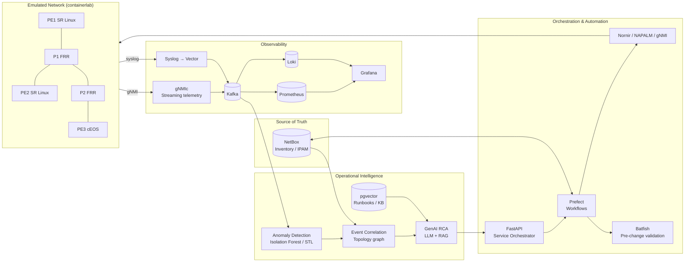

# NetOPS-AI-lab
# NetOps-AI Lab

**An open-source reference build of an AI-driven network automation and operational-intelligence platform for a carrier-grade IP/transport network.**

This project reproduces, end to end and on commodity hardware, the core workflows of a modern telecom automation role: network onboarding into a source of truth, service provisioning and activation, streaming telemetry, N/N+1 upgrade validation, anomaly detection, event correlation, and GenAI-assisted root-cause analysis.

> **Scope note.** This is an independent lab built entirely from public, open-source tools and synthetic data. It contains no proprietary code, configurations, topologies, data, or tooling from any employer or carrier.

---

## Table of Contents

1. [What This Lab Demonstrates](#what-this-lab-demonstrates)
2. [Architecture](#architecture)
3. [Tech Stack](#tech-stack)
4. [Repository Layout](#repository-layout)
5. [Quick Start](#quick-start)
6. [Modules](#modules)
7. [N/N+1 Upgrade Validation](#nn1-upgrade-validation)
8. [AI & Operational Intelligence](#ai--operational-intelligence)
9. [Testing & CI/CD](#testing--cicd)
10. [Documentation Set](#documentation-set)
11. [Build Roadmap](#build-roadmap)
12. [Role-to-Module Mapping](#role-to-module-mapping)

---

## What This Lab Demonstrates

| Capability | How it shows up here |
|---|---|
| Intelligent network automation | API-driven workflows that provision L3VPN / EVPN services and remediate faults |
| Operational platform validation | Reproducible N and N+1 lab environments with automated regression suites |
| Network & service onboarding | Device discovery → NetBox inventory → config baseline → assurance enrollment |
| Troubleshooting & operational intelligence | Log/telemetry pipelines, topology-aware event correlation, RCA reports |
| AI / ML / GenAI for operations | Anomaly detection on telemetry, alarm clustering, LLM-assisted RCA with RAG over runbooks |
| Documentation & best practices | Deployment guide, validation plan, onboarding SOP, runbooks, ADRs |

---

## Architecture



**Closed loop:** telemetry → anomaly → correlated incident → RCA with recommended action → validated remediation workflow → verification.

---

## Tech Stack

| Layer | Tools |
|---|---|
| Network emulation | [containerlab](https://containerlab.dev), Nokia SR Linux, FRRouting, Arista cEOS (optional) |
| Source of truth | NetBox (DCIM / IPAM / custom fields for services) |
| Device automation | Python 3.12, Nornir, NAPALM, scrapli, gNMI / gNMIc |
| Validation | Batfish, pyATS/Genie, pytest |
| Orchestration | FastAPI microservices, Prefect workflows, Kafka |
| Observability | gNMIc, Prometheus, Vector, Loki, Grafana |
| AI / ML | scikit-learn, statsmodels, NetworkX, pandas |
| GenAI | LLM API + retrieval (PostgreSQL + pgvector) |
| Platform | Linux, Docker / Docker Compose, GitHub Actions, pre-commit |

---

## Repository Layout

```
netops-ai-lab/
├── topologies/
│   ├── core-n.clab.yml            # Baseline (N) topology
│   └── core-n1.clab.yml           # Upgraded (N+1) topology
├── inventory/
│   ├── netbox_seed/               # Sites, devices, IPs, circuits (synthetic)
│   └── sync/                      # NetBox ⇄ device reconciliation
├── orchestrator/
│   ├── api/                       # FastAPI service catalog & order endpoints
│   ├── workflows/                 # Prefect flows: provision, activate, rollback
│   └── templates/                 # Jinja2 config templates per vendor
├── validation/
│   ├── batfish/                   # Pre-change reachability & policy checks
│   ├── pyats/                     # Post-change state verification
│   └── upgrade/                   # N vs N+1 regression suite
├── telemetry/
│   ├── gnmic.yml
│   ├── vector.toml
│   └── dashboards/                # Grafana JSON
├── intelligence/
│   ├── anomaly/                   # Interface / BGP / latency anomaly models
│   ├── correlation/               # Topology-aware alarm grouping
│   ├── rca/                       # LLM RCA agent + prompts + RAG indexer
│   └── datasets/                  # Synthetic fault-injection datasets
├── chaos/                         # Fault injection (link flap, BGP reset, CPU)
├── docs/
│   ├── deployment-guide.md
│   ├── validation-plan.md
│   ├── onboarding-sop.md
│   ├── runbooks/
│   └── adr/                       # Architecture Decision Records
├── tests/
├── docker-compose.yml
├── Makefile
└── .github/workflows/ci.yml
```

---

## Quick Start

**Requirements:** Linux host (or WSL2), 16 GB RAM minimum (32 GB recommended), Docker, containerlab, Python 3.12.

```bash
git clone https://github.com/<you>/netops-ai-lab.git
cd netops-ai-lab

make bootstrap        # venv, dependencies, pre-commit
make platform-up      # NetBox, Kafka, Prometheus, Loki, Grafana, Postgres
make lab-up           # Deploy baseline (N) topology via containerlab
make onboard          # Discover devices, populate NetBox, baseline configs
make telemetry-up     # Start gNMIc + Vector pipelines
make demo-fault       # Inject a fault and watch detection → RCA → remediation
```

| Service | URL |
|---|---|
| Grafana | http://localhost:3000 |
| NetBox | http://localhost:8000 |
| Orchestrator API docs | http://localhost:8080/docs |
| Prefect UI | http://localhost:4200 |

---

## Modules

### 1. Network & Service Onboarding
- Discovers devices via gNMI/NETCONF, pulls facts with NAPALM, and creates or updates NetBox objects.
- Reconciliation job flags drift between NetBox (intended) and device state (actual).
- Enrolls onboarded devices into telemetry and assurance automatically.

### 2. Service Provisioning & Activation
- `POST /services` accepts an L3VPN or EVPN order → validates against NetBox → renders vendor configs.
- Batfish runs pre-change checks (reachability, no route leaks, ACL impact).
- Prefect workflow applies the change, verifies with pyATS, and rolls back automatically on failure.
- Every step emits an event to Kafka for full lifecycle traceability.

### 3. Inventory Synchronization
- Scheduled and event-driven sync between devices and NetBox.
- Data integrity report: missing interfaces, IP conflicts, orphaned circuits, config drift.

### 4. Observability
- gNMI streaming for interface counters, optical levels (simulated), BGP/IS-IS state, CPU/memory.
- Syslog normalized by Vector into structured events.
- Grafana dashboards per layer: device health, service health, automation workflow success rate.

---

## N/N+1 Upgrade Validation

Replicates how operations teams qualify a new software release before production.

1. Stand up `core-n` (current release) and `core-n1` (candidate release) side by side.
2. Run the identical regression suite against both:
   - Control plane convergence (IS-IS, BGP) and timing
   - Service reachability for every provisioned VPN
   - Telemetry path compatibility (gNMI paths still valid)
   - Automation compatibility (templates, APIs, NetBox sync)
3. Produce a diff report: pass/fail matrix, behavior changes, convergence deltas, go/no-go recommendation.

```bash
make upgrade-validate FROM=core-n TO=core-n1
```

---

## AI & Operational Intelligence

| Use case | Approach |
|---|---|
| **Anomaly detection** | Seasonal decomposition + Isolation Forest on interface errors, latency, and BGP prefix counts |
| **Event correlation** | Alarms grouped by time window and topology adjacency (NetBox graph in NetworkX) to suppress symptom noise and surface probable root nodes |
| **Log analysis** | Template mining (Drain3) to cluster syslog patterns and flag novel messages |
| **Predictive analytics** | Trend forecasting on optical power / error rates to predict degradation before outage |
| **GenAI RCA** | LLM receives the correlated incident, recent changes, and relevant telemetry, retrieves matching runbooks from pgvector, and drafts an RCA with evidence and a recommended remediation workflow |
| **Test automation** | LLM-assisted generation of pyATS test cases from service definitions |

**Guardrails:** the RCA agent recommends; it never executes. Remediation runs only through validated Prefect workflows with Batfish pre-checks and human approval.

**Evaluation:** fault-injection scenarios in `chaos/` produce labeled ground truth, so detection precision/recall, time-to-detect, and RCA accuracy are measured, not asserted.

---

## Testing & CI/CD

- **Unit tests:** templates, parsers, correlation logic (`pytest`)
- **Integration tests:** spin up a minimal topology in CI with containerlab and run provisioning end to end
- **Static checks:** ruff, mypy, yamllint, Batfish policy checks on rendered configs
- **Pipeline:** GitHub Actions — lint → unit → build images → integration lab → publish report

---

## Documentation Set

| Document | Purpose |
|---|---|
| `docs/deployment-guide.md` | Build the platform from zero |
| `docs/validation-plan.md` | Test strategy, entry/exit criteria, N/N+1 procedure |
| `docs/onboarding-sop.md` | Step-by-step device and service onboarding |
| `docs/runbooks/` | Troubleshooting for BGP down, link flap, telemetry gap, sync drift |
| `docs/adr/` | Why NetBox, why Prefect, why Isolation Forest, LLM guardrail design |

---

## Build Roadmap

| Phase | Deliverable | Est. effort |
|---|---|---|
| 1 | containerlab topology + NetBox seeded + onboarding script | 1 week |
| 2 | Telemetry pipeline + Grafana dashboards | 1 week |
| 3 | Service provisioning API + Prefect workflows + Batfish/pyATS checks | 2 weeks |
| 4 | N/N+1 upgrade validation suite + report generator | 1 week |
| 5 | Anomaly detection + event correlation + fault injection | 2 weeks |
| 6 | GenAI RCA agent with RAG over runbooks | 1–2 weeks |
| 7 | CI/CD, docs, demo video | 1 week |

---

## Role-to-Module Mapping

| Role requirement | Module |
|---|---|
| AI-driven automation solutions | `orchestrator/`, `intelligence/rca/` |
| Automation workflows via APIs & orchestration | `orchestrator/api`, `orchestrator/workflows` |
| Inventory sync, orchestration, telemetry validation | `inventory/sync`, `validation/`, `telemetry/` |
| N/N+1 lab environments | `topologies/`, `validation/upgrade/` |
| Software upgrades, interoperability, readiness | `validation/upgrade/` |
| Network & service onboarding | `inventory/`, `docs/onboarding-sop.md` |
| Provisioning, activation, assurance, lifecycle | `orchestrator/workflows` |
| Log/telemetry analysis, RCA | `intelligence/`, `docs/runbooks/` |
| Anomaly detection, event correlation, predictive analytics | `intelligence/anomaly`, `intelligence/correlation` |
| Test automation | `tests/`, `validation/pyats`, LLM test generation |
| Python, APIs, microservices, Linux, Git, containers, CI/CD | Entire repository |
| Documentation & best practices | `docs/` |

---

## License
TBD
